## Product walkthrough

> This walkthrough follows the user's journey through Finn Lens, from figuring out what matters to them to understanding how the available cars compare.
>
> ---
>
> ### 1. Meet Lens
>
> When you first install Finn Lens, it opens the listings page on finn.com and introduces itself through the chat.
>
> 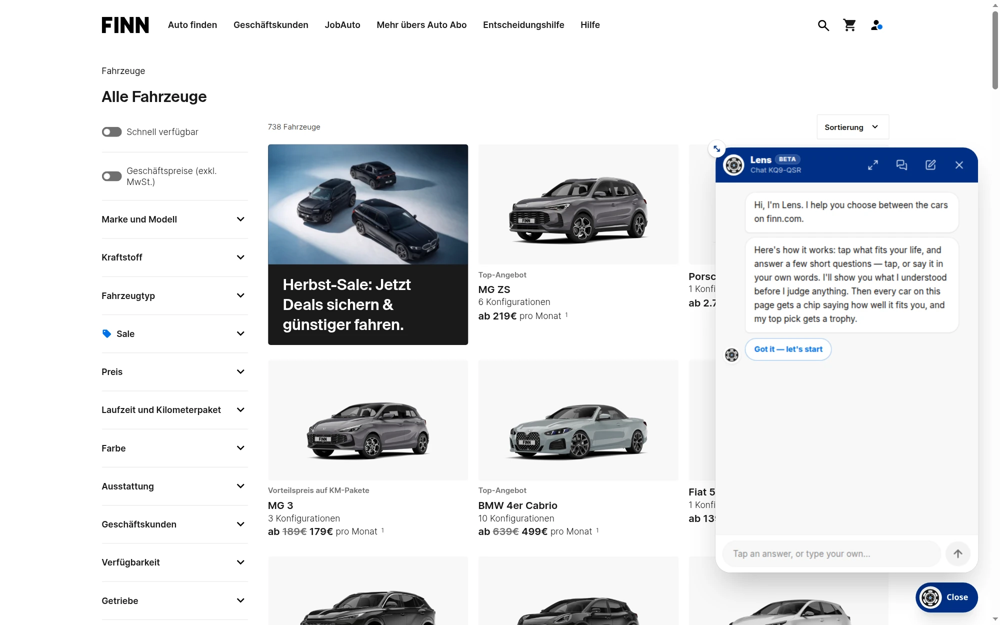
>
> Lens explains what it does, how the conversation works, and what to expect from the results. You can answer by selecting options or, where a question allows it, entering a value of your own.
>
> The idea is straightforward: before judging the cars, Lens wants to understand the person choosing them.
>
> ---
>
> ### 2. Tell Lens about your life
>
> The conversation consists of questions and follow-up questions. Your answers help Lens build a picture of your circumstances, identify relevant vehicle features, and determine which preferences matter most.
>
> > #### 2.1. Who rides with you?
> >
> > 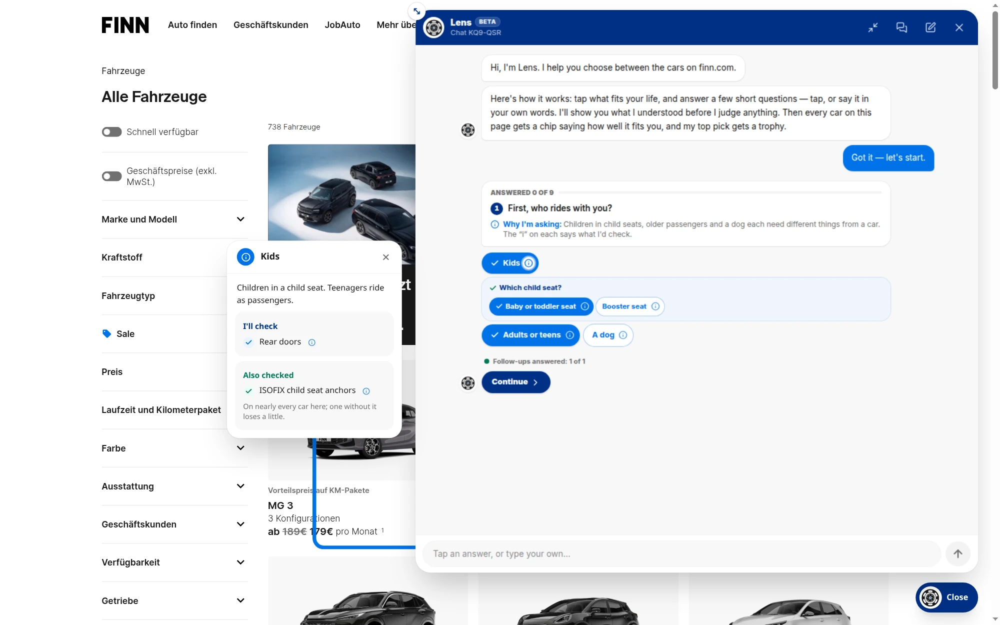
> >
> > Lens starts by asking who regularly travels with you. Children in child seats, older passengers, teenagers, and dogs can have different implications for what makes a car suitable.
> >
> > Some answers lead to follow-up questions. For example, selecting children prompts you to specify the kind of child seat you need.
> >
> > Lens also explains what it will check and why. In this example, it identifies rear doors as relevant and checks for ISOFIX child-seat anchors.
> >
> > The information icon provides additional context, so users can understand what an answer means to Lens rather than simply selecting an option and hoping for the best.
> >
> > ---
> >
> > #### 2.2. Where and how do you drive?
> >
> > 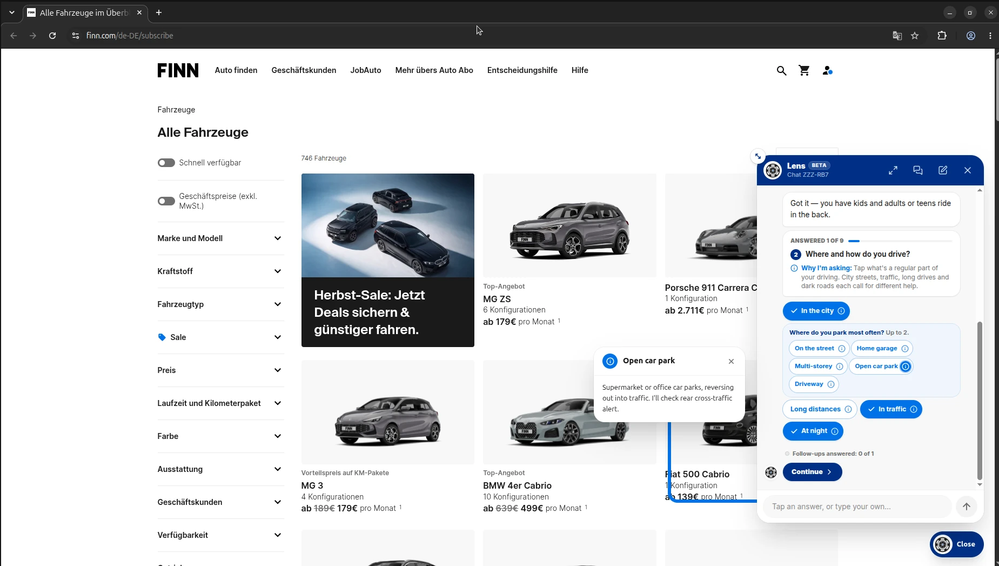
> >
> > Next, Lens asks about your driving habits and the environments you regularly encounter.
> >
> > City driving, traffic, long-distance journeys, and parking situations can all affect which features are useful to you.
> >
> > Some answers lead to more specific questions. Selecting city driving, for example, lets you describe where you usually park.
> >
> > Lens then connects those answers to relevant vehicle features. In the open-car-park example, it explains that reversing out of a parking space into traffic is a situation where rear cross-traffic alert may be useful.
> >
> > The purpose isn't to recommend every available driver-assistance feature. It's to identify the ones that make sense for your circumstances.
> >
> > ---
> >
> > #### 2.3. What does the car need to cope with?
> >
> > 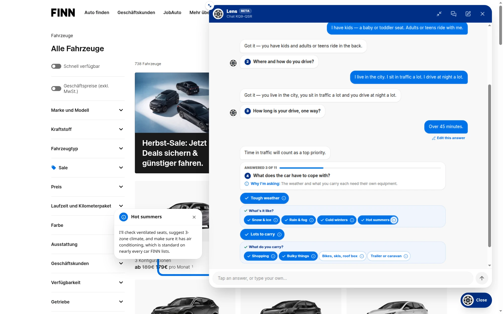
> >
> > Lens also asks about the conditions the car needs to handle and what you regularly carry.
> >
> > For example, someone dealing with cold winters, snow and ice may benefit from different equipment than someone primarily driving in hot weather. Similarly, carrying shopping is different from regularly transporting bulky items, bikes, or other equipment.
> >
> > Follow-up questions help Lens narrow down the relevant requirements.
> >
> > If you select hot summers, for instance, Lens explains that it will check for ventilated seats, consider three-zone climate control, and check for air conditioning.
> >
> > These explanations make the connection between your answers and the vehicle features Lens evaluates more explicit.
> >
> > ---
> >
> > #### 2.4. Build on earlier answers
> >
> > 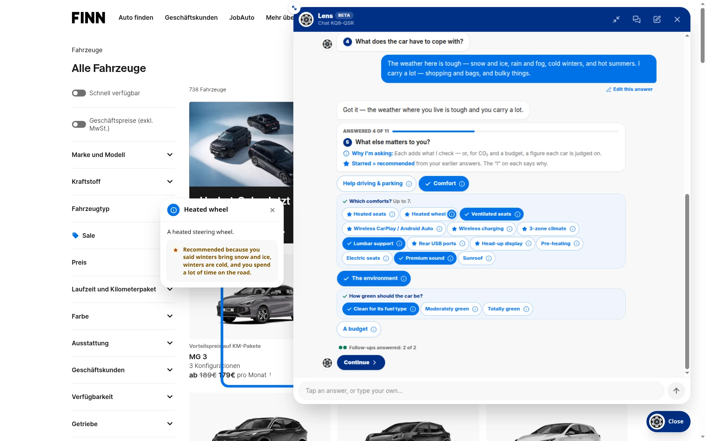
> >
> > As the conversation progresses, Lens can recommend additional options based on what you've already told it.
> >
> > In this example, I indicated that I experience cold winters with snow and ice and spend considerable time driving. When I reached the comfort preferences, Lens recommended a heated steering wheel.
> >
> > The tooltip explains why:
> >
> > > Recommended because you said winters bring snow and ice, winters are cold, and you spend a lot of time on the road.
> >
> > This is an important distinction. Lens isn't merely presenting a static list of features for the user to select. It uses earlier answers to suggest features that may be relevant to the user's circumstances.
> >
> > The user remains in control, though. A recommendation is a suggestion, not an obligation to include that feature in their priorities.
> >
> > ---
> >
> > #### 2.5. Tell Lens what else matters to you
> >
> > 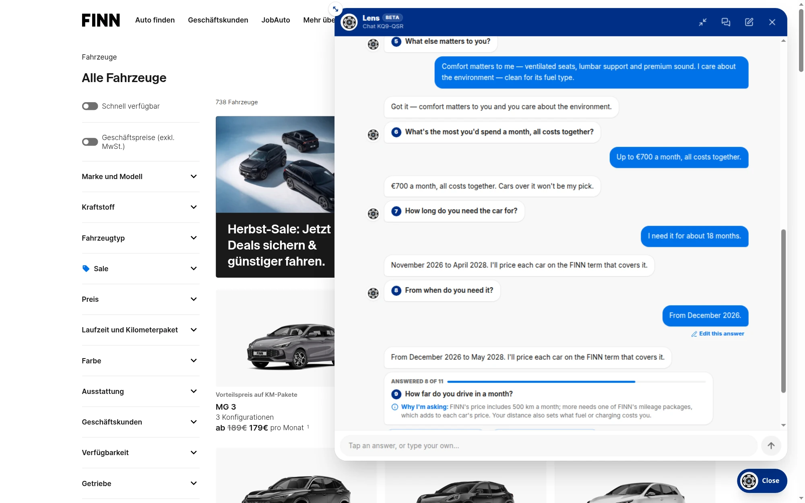
> >
> > Beyond practical requirements, Lens asks about other preferences, including comfort and environmental considerations.
> >
> > You can choose specific comfort features and say how green the car should be. Lens also asks about your budget and how long you need the car.
> >
> > It then recounts your answers in natural language.
> >
> > For example, the conversation might look like this:
> >
> > > **You:** Comfort matters to me — ventilated seats, lumbar support and premium sound. I care about the environment — clean for its fuel type.
> > >
> > > **Lens:** Got it — comfort matters to you and you care about the environment.
> >
> > Budget and rental duration are handled separately from these preferences. In this example, Lens interprets a monthly budget of €700 as a constraint and works out the rental term needed to cover the requested period.
> >
> > This distinction matters: a preference helps Lens compare suitable cars, while a hard constraint can rule out a car that doesn't meet the requirement.
> >
> > ---
> >
> > #### 2.6. Understand the choices Lens recommends
> >
> > 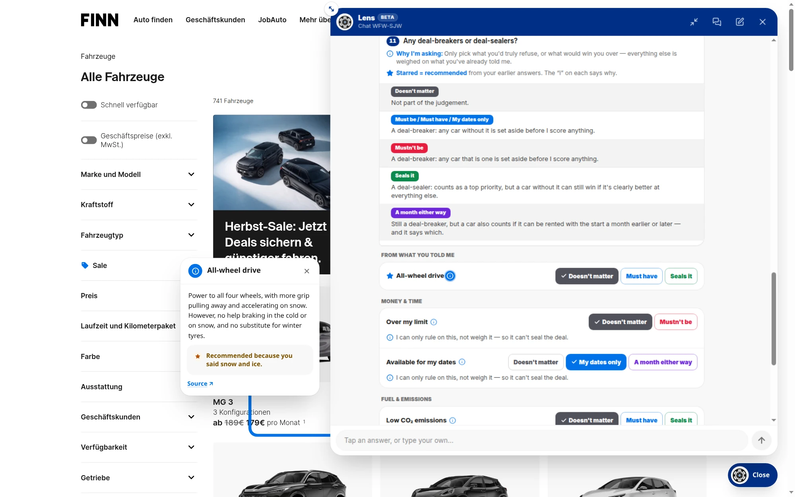
> >
> > Lens uses visual indicators to distinguish different kinds of choices, and the information tooltips explain what individual options mean and why they may be relevant.
> >
> > For example, if you've indicated that you regularly encounter snow and ice, Lens may recommend considering all-wheel drive (AWD).
> >
> > 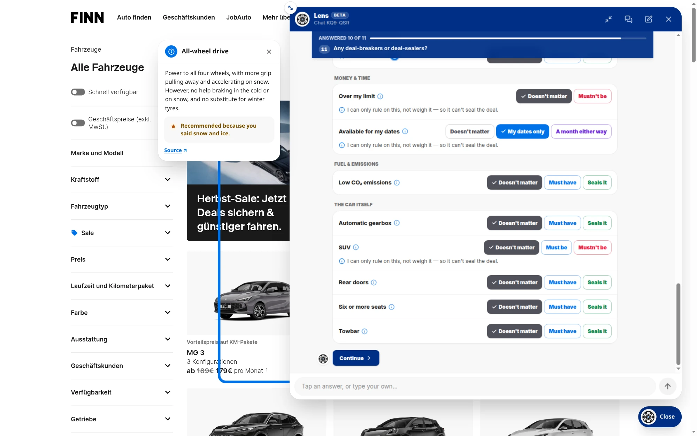
> >
> > The tooltip explains the trade-off: AWD can improve traction when accelerating on snow, but it doesn't improve braking on snow or replace appropriate winter tyres.
> >
> > The source link provides supporting information for the claim, allowing users to inspect the reasoning rather than having to take Lens's word for it.
> >
> > The point isn't that every recommendation will be right for every person. It's that the recommendation should come with enough context for the user to decide whether it makes sense.
>
> ---
>
> ### 3. Review and refine Lens's understanding
>
> Before evaluating the cars, Lens summarizes what it has learned from the conversation.
>
> > #### 3.1. See how your answers are interpreted
> >
> > 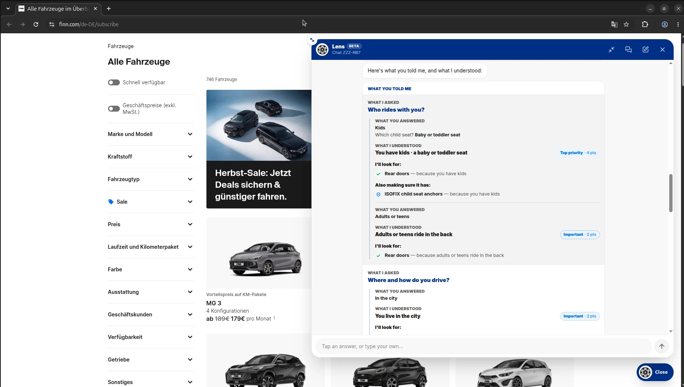
> >
> > The summary brings together your answers, the requirements Lens derived from them, and the relative importance assigned to your preferences.
> >
> > The priority levels work as follows:
> >
> > - **Top priority (4):** Counts twice as much as Important. A car can still win without meeting a top priority, but it needs to compensate by performing better elsewhere.
> > - **Important (2):** Receives the standard priority weight and contributes fully to the comparison.
> > - **Nice to have (1):** Counts half as much as Important and can help distinguish between otherwise similar cars.
> >
> > A dashed outline on how much something counts marks Lens's own guess from your answers, rather than a level you picked yourself.
> >
> > This distinction helps you identify where Lens is interpreting your needs instead of simply recording your choices.
> >
> > ---
> >
> > #### 3.2. Confirm or correct the summary
> >
> > 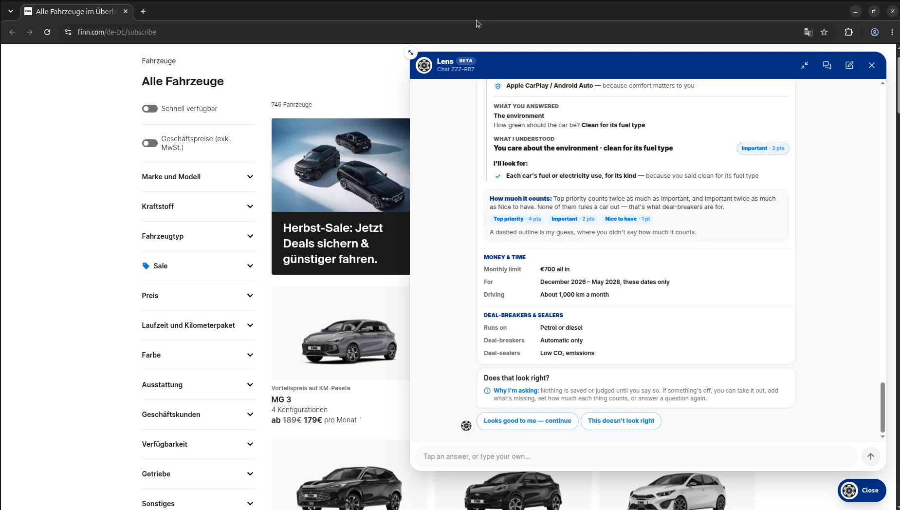
> >
> > Once the summary is ready, Lens asks whether its understanding looks right or needs adjustment.
> >
> > If something is wrong, you can select the option indicating that the summary doesn't look right.
> >
> > 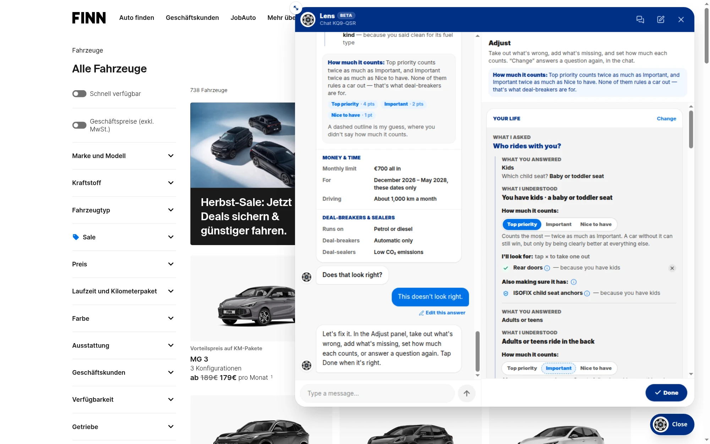
> >
> > The adjustment panel presents the same underlying information in an editable form. You can review the questions and answers, the requirements Lens derived from them, and how it interpreted their importance.
> >
> > You can then adjust the selections until the summary better reflects what you actually meant.
> >
> > This is deliberate: Lens should give users an opportunity to correct its interpretation before using that interpretation to evaluate cars.
> >
> > ---
> >
> > #### 3.3. Decide whether to save your settings
> >
> > 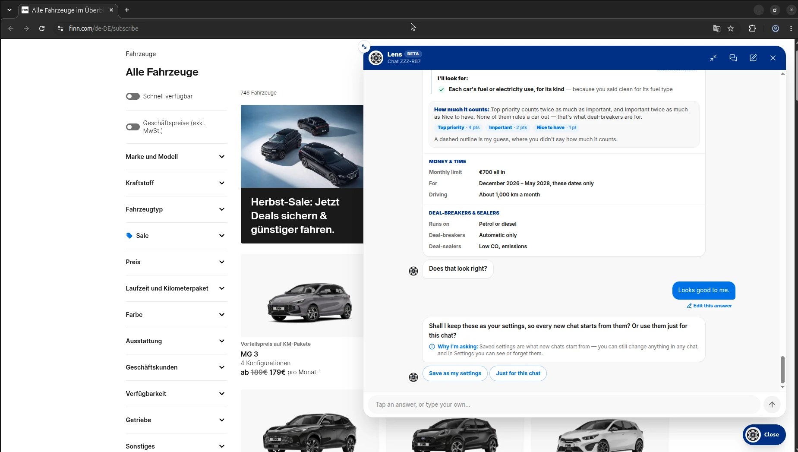
> >
> > Once you've confirmed your answers, Lens asks whether you'd like to save them as your settings or use them only for the current conversation.
> >
> > Saved settings provide a starting point for future chats, so you don't have to repeat the entire process each time. You can still change your answers in a future conversation, and you can review or forget your saved settings through Settings.
> >
> > Choosing to use the answers only for the current chat lets you proceed without saving them as your default preferences.
>
> ---
>
> ### 4. Explore your results
>
> Once the requirements have been confirmed, Lens evaluates the cars on the listings page and displays the results.
>
> > #### 4.1. See how each car fits
> >
> > 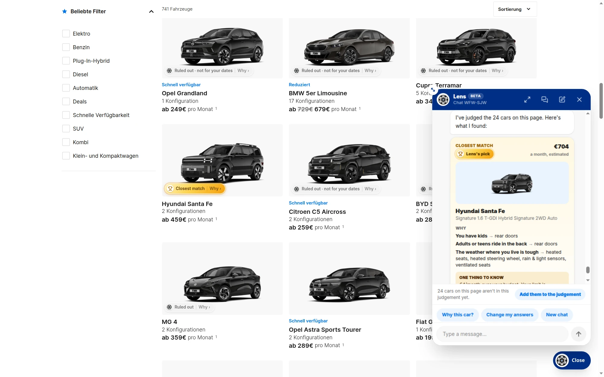
> >
> > Lens attaches a clickable result chip to each car it evaluates. The chips distinguish the top pick from cars that may still be suitable and cars that have been ruled out.
> >
> > The chips aren't just labels. Clicking one opens a drawer with a breakdown of that car's evaluation, whether it won or not.
> >
> > This means you can inspect the runner-up, understand why a car lost against the winner, or find out why another car was ruled out entirely.
> >
> > The goal isn't simply to identify one winner and leave you to guess what happened to the other options. Every evaluated car has a reason for its result, and Lens gives you a way to explore it.
> >
> > ---
> >
> > #### 4.2. Inspect the reasoning behind a result
> >
> > 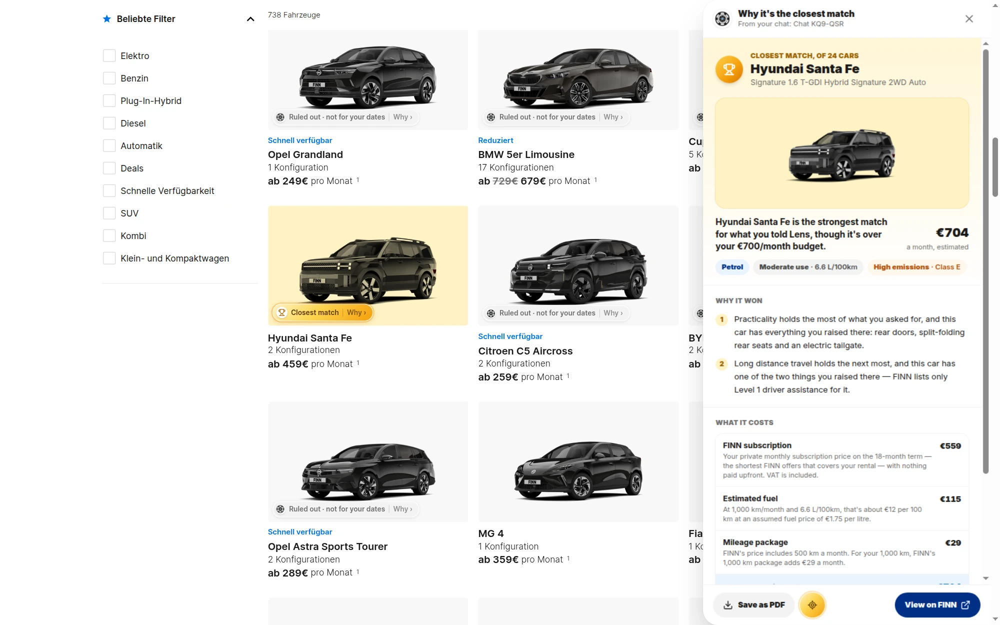
> >
> > Clicking a car's result chip opens its evaluation drawer, where you can inspect the reasoning behind its outcome.
> >
> > For the top pick, the breakdown helps explain why it came out ahead. For another suitable car, it can show where it fell short compared with the winner. For a car that was ruled out, it explains why it didn't qualify.
> >
> > This lets you compare the reasoning across different cars instead of treating the top pick as an answer you have to accept on faith.
> >
> > A top pick is ultimately the result of applying Lens's predefined scoring model to your stated needs and priorities. It isn't a guarantee that the car is the right choice for everyone.

---

## A note on the current beta

> Finn Lens currently uses a predefined scoring system to evaluate cars against the user's requirements and priorities. The conversational interface helps gather and interpret those requirements, but natural-language AI integration is a potential future enhancement, not part of the current beta.
>
> The quality of the results depends on the vehicle data available, the assumptions built into the scoring model, and the accuracy of the user's answers. The results should therefore be treated as decision support, not definitive advice.
>
> ---
>
> Finn Lens is an independent project and is not an official FINN product.